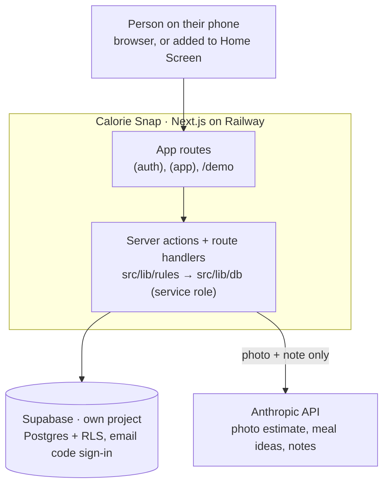

# DESIGN — Calorie Snap

As of 2026-11-25. Source: the design canvas "Calorie Snap – App Mockup" (claude.ai) and its interactive prototype, played through screen by screen. The prototype mocks the photo estimate ("a real build would send the photo to a vision model"). Where this file and the prototype disagree, the prototype wins for **what the user sees**; this file wins for **how it is built**. Decisions the prototype does not cover are marked *(build decision)*; the ones that change what users see are also in `QUESTIONS.md`.

## Summary
Calorie Snap helps an adult lose weight at a safe pace by logging what they eat, mostly from a photo.

- **For:** adults (18+) who want to lose weight and find calorie apps tedious. Not for pregnancy or breastfeeding.
- **Problem:** logging food is slow, so people stop. Weighing yourself every day is discouraging and noisy.
- **Loop:** snap the plate → correct the estimate in a few taps (swap, remove, add oil or sauce, portion) → Today shows what's left and what to eat next from foods you like → Progress estimates your weight from what you logged, checked against an occasional weigh-in.

## Design principles (read from the prototype; every task respects them)
1. **Estimates you can fix.** The photo is a starting point; every item can be swapped, removed or added, and a note explains what the photo can't see.
2. **No daily weigh-ins.** Weight is estimated from the log; a check-in every couple of weeks keeps it honest.
3. **Safe by default.** Adults only, a capped pace, a safe calorie minimum, support one tap away.
4. **Kind, never shaming.** Encouragement, plain numbers, no guilt words.
5. **Your foods.** Meal ideas come from the foods you said you like.

## Platform *(build decision)*
One Next.js app on Railway, one Supabase project per environment, the same stack and habits as Lash, Aquatix and Kindred.

- **One place for the numbers:** `src/lib/rules` (pure TypeScript). Every screen and the demo call it. The database only accepts writes from the server and guards ranges with constraints (`docs/schema.test.sql`).
- **The camera** is the browser's photo input; it opens the camera on iPhone and Android, with "Upload" for a photo already taken. The browser shrinks the photo (longest side 1568 px, JPEG) before sending it; the server never keeps it (Q3).

### What the web platform changes from the prototype
| The prototype | Here | Notes |
| --- | --- | --- |
| A live camera view with a framing guide and a shutter | The phone's own camera opens from the shutter button; the framing hint ("Fit the whole plate in the frame, shot from above") shows before it opens | A live in-page viewfinder (`getUserMedia`) can come later; the system camera is more reliable on iPhone. |
| App on the phone | A URL; "Add to Home Screen" offered after the third day of logging | A native wrapper later if testers ask (health app sync, widgets). |
| No sign-in shown | Email + 6-digit code before the first save (Q1); "Just looking?" opens `/demo` with no account | |

## Repo layout
See `CLAUDE.md` "Layout".

## Core concepts
| Term | Meaning |
| --- | --- |
| Burn (maintenance) | Calories the body uses a day, estimated from sex, age, height, current weight and activity (CS-02). "You burn". |
| Daily limit | Burn minus the deficit for the chosen pace, never below the safe minimum (CS-05). "Eat up to". |
| Deficit | Burn minus what was eaten that day. 7,700 kcal ≈ 1 kg (CS-10). |
| Pace | Planned loss per week: 0.25, 0.5, 0.75 or 1 kg, capped at ~1% of body weight (CS-04). |
| Food list | Foods the person likes; used for meal ideas (CS-17). |
| Scan | A photo turned into an estimate: a name, items with amounts and calories, macros, a confidence (CS-14). |
| Note | A correction the photo can't see ("cooked in butter", "didn't finish", "+150 kcal"), as a chip or typed (CS-15). |
| Check-in | A weigh-in. Anchors the estimated weight (CS-11). |
| Simulated example | Eight weeks of sample data to look around, clearly labelled; "Start fresh" clears it (CS-21). |

## Screens (from the prototype)
Bottom bar on every main screen: **Today**, **Progress**, a raised round green **scan** button in the middle, **Foods**, **Profile**. The active tab is green.

- **Start: "What do you like to eat?"** (once, after sign-in; scan icon badge on top). "Add the foods you enjoy to your list. You can change it any time in the Foods tab." Add a food (text box "e.g. chicken, rice, bananas" + **Add**; "Added: Chicken" confirmation line); **My food list · N foods** as removable green chips ("Nothing yet." when empty); **Or tap to add** chips (Chicken, Eggs, Rice, Bread, Banana, Apple, Berries, Salmon, Tuna, Shrimp, Beef, Turkey, Pasta, Potatoes, Oats, Greek yogurt, then Cheese, Peanut butter, Jam, Avocado as earlier ones are taken). Main button **Continue** (0 foods) / **Save my list** (1+). Under it: "For adults 18+. Not for use during pregnancy or breastfeeding." · dashed **Just looking? See a simulated example** · **Skip for now**. After it: Profile.
- **Profile:** "Your body, your goal and your daily numbers."
  - **1 About you** · "Used to work out what your body burns": Sex (Female / Male), Age, Height cm, Start weight kg, How active are you? (Light / Moderate / Active, with a line: "Exercise 3–5 days a week" for Moderate; Light and Active lines Q-free defaults in `en-CA.ts`: "Little or no exercise", "Hard exercise 6–7 days a week").
  - **2 Your goal** · "How much you want to lose, and how fast": Goal weight kg, **To lose** tile ("– kg" until filled, then "10.0 kg"); Pace 0.25 / 0.5 / 0.75 / 1 kg* with "Per week. Recommended for most people." (0.5) or "* Capped at 0.8 kg for you, about 1% of your body weight, to protect muscle."; "Fill in your details to see your timeline." until complete, then "Lose 10.0 kg in about 20 weeks, by April 14, 2027."
  - **3 Your daily numbers** (dark card) · "Worked out from steps 1 and 2, and used across the app": You burn 2830 kcal/day · Eat up to 2280 kcal/day (mint) · Protein 145 g/day · "That's a 550 kcal daily deficit." When capped: amber ⚠ "Pace limited to 0.8 kg a week, about 1% of your body weight. Faster loss tends to cost muscle."
  - **Example data:** "You are starting from scratch. Load the example to see how the app looks after a few weeks." / "You are viewing a simulated example: 8 weeks of sample meals and check-ins. Start fresh to clear it and begin today." · **Load simulated example** · **Start fresh**.
  - **Food or your body feeling hard?** "You don't have to figure it out alone. In Canada, NEDIC offers a free, confidential helpline and chat about eating and body image." **Call 1-866-633-4220** · **Chat at nedic.ca**. Then: "Calorie Snap gives estimates, not medical advice. Check with a doctor before losing weight if you have a health condition or take medication."
  - The prototype's sticky note lists "4 Fine-tune" but no such section is on screen (Q20).
- **Today:** date ("Tuesday, Nov 24"), title. In the example, a lavender banner "Simulated example with sample data" + **Start fresh**. **Ring card:** a ring filling green with "1030 kcal left"; Daily limit 2220 kcal · Eaten 1190 kcal · Deficit so far 1,580 kcal · "Ends near 550 if you eat to your limit". **Macros:** Protein (blue), Carbs (rust), Fat (purple) bars: "71 / 135 g · 64 g to go" (or "· goal met", Q10); a green tip: "You still need 64 g protein in 1030 kcal. Lean options like chicken, fish, eggs or tofu fit best." **Meal suggestions** · "From foods you like · each fits your 1030 kcal left": **Suggest a meal** → a card (tag "Balanced", "Light chicken fried rice", 520 kcal, "You like chicken & rice", P 35g · C 60g · F 14g) and **Suggest another**. **Food log** with **+ Add food** (opens Scan): rows with a coloured initial tile, name, "Breakfast · 8:10 AM · P 22g · C 34g · F 6g", kcal, ×. Footer: "You burn about 2,770 kcal a day. This is an estimate from your profile, used to work out your deficit."
- **Scan: "Snap your food"** (dark screen, "1030 kcal left" top right). Plate frame, "Fit the whole plate in the frame, shot from above.", **Upload** · shutter · **Cancel**; **Forgot a photo? Add it manually**; **Or log a recent meal** (recent meals with kcal · protein and a + button).
  - **Estimate** (light card on the dark screen): "Estimated from photo · 87% confident", name ("Margherita pizza, 2 slices"), kcal, Protein / Carbs / Fat tiles. **What we found** · "Wrong? Swap or remove items": rows (name, amount · kcal, an optional **Swap: Regular-crust pizza**, ×); dashed add chips **+ Sauce or dressing**, **+ Cooking oil**, **+ Side of bread**. **Add a note to correct the estimate:** "Photos can't see oil, butter or sauces. Try "cooked in butter", "no rice", "didn't finish" or "+150 kcal"." Chips: Cooked in oil, Butter, Extra cheese, Extra sauce, Bigger portion, Smaller portion, Didn't finish; a text box; **Apply note**; result lines "Updated: added cooking oil (+120 kcal)" and "Saved with this meal: "Cooked in oil"". **Portion** − 1× +. "After this you'll have 390 kcal left." **Which meal?** Breakfast / Lunch / Dinner / Snack (pre-selected by the time, CS-16). **Retake** · **Add to today** → Today.
  - **Add it manually:** "‹ Back to camera", **Search for a food or meal** ("e.g. pizza, oatmeal, apple"), **Popular foods** (name, P·C·F, kcal; e.g. "Grilled chicken, quinoa & greens 480 kcal", "An apple 95", "Greek yogurt, 170 g 100", "A bowl of oatmeal 160", "A slice of thin-crust pizza 240", "Half a turkey sandwich 220"), **Not on the list? Quick add** (Food, kcal, **Continue**). A picked food goes to the same review card (portion, meal, Add to today).
- **Progress:** "Estimated from the calories you log. No daily weigh-ins needed." Tiles Start 86.0 kg · Now (est.) 81.8 kg (blue) · Goal 75 kg (green). **Weight** card ("about −4.2 kg so far"): chart from the start date to the goal date, dashed green Plan line, solid blue You line from the food log with shading, orange check-in dots, dotted "If you keep going" line, a Goal kg line, "Today" marker; legend. Tiles Projected today 82.0 kg · You today 81.8 kg · Difference On plan; a progress bar "38% of the way · about 6.8 kg to go". **Projection** (green card): "Stick to 2220 kcal a day and you reach 75 kg around Mar 1, 2027. That is about 0.50 kg a week. So far you have averaged a 571 kcal daily deficit." **Check-in:** "Last weigh-in was 2 weeks ago (Nov 10). A quick check keeps the estimate honest." weight box + **Save**; "Plan vs you: On plan · You are right where your plan says you should be."; a dark encouragement card with a star and ↻ ("Small steps, every day. You are doing exactly that."); **BMI (est.)** 25.8 on a coloured scale, "Overweight range". **Calorie deficit** · "vs 2770 kcal maintenance": Last 6 full days 5,995 kcal total deficit · Equals about 0.78 kg of fat lost (7,700 kcal ≈ 1 kg); seven day chips (−1050 W … −550 T); "Eating to your 2220 kcal limit every day is a 550 kcal daily deficit, about 0.50 kg a week." **Calories this week** (avg 1779/day): bars per day, green under, orange over, dashed limit line, legend. **Daily history** ("2-day streak on target"): rows Day · Eaten with a bar · Under / Over / Too low · Deficit · ›; "Tap a day to see what you ate." **Weigh-ins** (N entries): date, kg, change, "Start".
- **Day detail** (from Daily history): back arrow, "Sunday, Nov 22", Eaten 1,425 / 2,220 kcal; when under the minimum a peach box "Below the safe minimum of 1500 kcal. Eating this little often can cost muscle, energy and mood."; Calorie deficit 1,345 kcal · That's about 175 g of fat burned (est.); Macros with "30 g short"; **What you ate · 5 items** (meal, time, name, P·C·F, kcal).
- **Foods:** "Keep a list of the foods you enjoy." Add a food; **Or tap to add common foods** (the chips not yet on the list); **My food list** · N foods with × per food.

Fixes to the prototype's copy *(build decision)*: "1030 kcal kcal left" → "1030 kcal left"; Fat "goal met" when over the target → see Q10.

## Rules (CS-xx). Implemented once in `src/lib/rules`, tested by id.
Error codes are stable strings; the UI maps them to copy in `src/lib/i18n/en-CA.ts`.

| Id | Rule | Codes |
| --- | --- | --- |
| CS-01 | Eligibility: the person confirms they are 18 or older and not pregnant or breastfeeding before any goal is saved (one checkbox on Start, its time stored). Age under 18 in About you is refused. | `NOT_ELIGIBLE`, `AGE_UNDER_18` |
| CS-02 | **Burn** = Mifflin–St Jeor BMR × activity, rounded to 10. BMR = 10 × kg + 6.25 × cm − 5 × age + 5 (male) or − 161 (female). Activity: Light 1.375, Moderate 1.55, Active 1.725. Weight = the latest check-in, else the start weight. Age from `age_years` + whole years since `age_recorded_on`. | `PROFILE_INCOMPLETE` |
| CS-03 | Goal weight: below the current weight, at least 1 kg less, and at a BMI of at least 18.5 for the height (Q6). Inputs: age 18–100, height 120–230 cm, weight 35–300 kg. | `GOAL_NOT_BELOW`, `GOAL_TOO_LOW`, `OUT_OF_RANGE` |
| CS-04 | Pace: 0.25, 0.5 (default), 0.75 or 1 kg a week. Cap = 1% of current weight rounded down to 0.05 kg; a choice above the cap uses the cap and shows the ⚠ line. | — |
| CS-05 | **Daily limit** = burn − pace × 7700 / 7, rounded to 10, never below the safe minimum: 1500 kcal (male), 1200 (female) (Q5). When the minimum binds, the shown pace and timeline use the real deficit (burn − limit). | — |
| CS-06 | Macro targets: **protein** = 1.6 g × current kg, rounded to 5 (a minimum, "to go" / "goal met"); **fat** = 0.8 g × current kg, rounded to 5; **carbs** = what's left of the limit after protein and fat, ÷ 4, rounded to 5 (Q4). | — |
| CS-07 | Timeline: to lose = estimated weight (CS-11) − goal; weeks = to lose ÷ effective pace, one decimal ("about 8.5 weeks", whole numbers shown without ".0"); date = today + ⌈weeks × 7⌉ days, "by April 14, 2027". Re-computed on every change. **Which weight where** *(read from the prototype)*: burn, protein, fat and the pace cap use the latest check-in (else start); To lose, timeline, BMI and the projection use the estimated weight. | — |
| CS-08 | Today: **left** = limit − eaten (below zero: "N kcal over", ring full in amber); **deficit so far** = burn − eaten; **ends near** = burn − limit. Totals are the sums of today's meals (`local_date` = today in the user's zone). | — |
| CS-09 | Protein tip: if protein left ≥ 15 g and kcal left > 0: "You still need {g} g protein in {kcal} kcal…"; if kcal left ≤ 0, no tip. | — |
| CS-10 | Deficit maths: a day's deficit = burn − eaten; 7,700 kcal ≈ 1 kg; fat burned (est.) in grams = deficit ÷ 7.7, rounded to 5. **Only days with at least one meal logged count** (an empty day is "Not logged", never a full-burn deficit) *(build decision, Q13)*. "Last N full days" = completed logged days in the last 7. | — |
| CS-11 | **Estimated weight** ("Now (est.)") = the latest check-in − the sum of deficits of logged days after it ÷ 7700, to 0.1 kg; with no check-in, the start weight from the start date. **Plan** line = start − pace × weeks since start (to the goal). Difference = est − plan: within ±0.5 kg "On plan", lower "Ahead of plan", higher "Behind plan" (Q14). "% of the way" = (start − est) ÷ (start − goal). Projection: reach goal at est weight ÷ pace from today. | — |
| CS-12 | Day status (Daily history, bars): **Under** (≤ limit and ≥ minimum), **Over** (> limit, orange), **Too low** (< minimum, orange words; completed days only; today is never Too low). **Streak** = consecutive days ending today (or yesterday if today has nothing yet) that are Under. Too low and Over end it. | — |
| CS-13 | Check-in: one weight per day (a second replaces the first); 35–300 kg. The Progress card asks for one when the last is ≥ 14 days old ("A quick check keeps the estimate honest"); it is never required. | `OUT_OF_RANGE` |
| CS-14 | Photo estimate: the vision integration returns `{name, confidence 0–1, items[{name, amount, kcal, protein, carbs, fat, swap?}]}`. Each item 0–3000 kcal, macros 0–300 g; a meal 0–5000 kcal. Under 0.5 confidence the card says "Not sure about this one · check the items"; no food found → "We couldn't see food in this photo" + Retake / Add it manually. Scans per user per day are limited (Q8). | `NO_FOOD_FOUND`, `SCAN_LIMIT`, `ESTIMATE_FAILED` |
| CS-15 | Corrections: × removes an item; Swap replaces it with the model's alternative; add chips add a catalogue item; note chips are fixed adjustments from `src/lib/catalog/adjustments.ts` (Cooked in oil = + Cooking oil 1 tbsp 120 kcal F 14 g; Butter = + 1 tbsp 100 kcal F 11 g; Extra cheese = + 30 g 110 kcal; Extra sauce = + 60 kcal; Bigger portion = ×1.25; Smaller portion = ×0.75; Didn't finish = ×0.75) (Q16). A typed note: "+N kcal" / "−N kcal" is applied directly; anything else goes to the model to re-estimate (fallback: kept as a note only, "We couldn't use that note; change the items instead"). Portion steps of 0.25 from 0.25× to 3×, applied to all items. The note text is saved with the meal. | `NOTE_NOT_UNDERSTOOD` |
| CS-16 | Meal type, pre-selected from the local time when the meal is added: Breakfast 4:00–10:59, Lunch 11:00–14:59, Dinner 17:00–21:29, Snack otherwise (Q15). Always changeable. | — |
| CS-17 | Meal ideas: built from the food list; each fits kcal left (≤ left, ≥ 150), favours the protein gap, tagged Balanced / High protein / Light, with "You like X & Y" naming the liked foods used. Under 150 kcal left: "Nothing big left today · a piece of fruit or tea fits". With no foods on the list: "Add foods you like to get ideas" → Foods. AI first, built-in templates as the fallback. Logging an idea: Q7. | — |
| CS-18 | Food list: names 1–40 characters, trimmed, case-insensitive unique ("Chicken" = "chicken"); up to 100 foods. Quick chips hide foods already on the list. | `FOOD_EMPTY`, `FOOD_DUPLICATE`, `FOOD_LIST_FULL` |
| CS-19 | Meals: name 1–80, kcal 0–5000 (quick add requires kcal ≥ 1), macros 0–500 g, portion 0.25–3. A meal can be removed (×) and, for today and the past 7 days, edited (portion, meal type) (Q18). Logging for a past day: Q18. | `MEAL_INVALID` |
| CS-20 | Tone: encouragement lines come from a fixed list in `en-CA.ts` and rotate with ↻; never shown for a Too low day; no words like cheat, bad, guilty, failed, punish. BMI shown with its range name only (Underweight < 18.5, Healthy 18.5–24.9, Overweight 25–29.9, Obesity ≥ 30), no advice attached. | — |
| CS-21 | Simulated example: `/demo` (no account) and "Load simulated example" (signed in) show 8 weeks of sample meals and 3 check-ins generated from a fixed seed relative to today, with the lavender banner on every screen. Signed in, it is held apart from real data (`profiles.demo_mode`, demo rows never mixed with real rows) and **Start fresh** deletes only demo rows. | — |
| CS-22 | Support: the NEDIC card and the medical line are always on Profile. After 3 Too low days within 7 days, Today shows the NEDIC card once a week (Q17). | — |

### Worked numbers from the prototype (T02 makes these test cases)
| Case | Input | Expected |
| --- | --- | --- |
| CS-02a | Male, 42 y, 178 cm, 92 kg, Moderate | Burn 2830 |
| CS-02b | Male, 32 y, 178 cm, latest check-in 83.1 kg (start 86.0), Moderate | Burn 2770 (uses the check-in) |
| CS-05a | Burn 2830, pace 0.5 | Limit 2280, deficit 550 |
| CS-04a | Current 83.1 kg, pace 1 kg chosen | Cap 0.8; deficit 880; limit 1890; ⚠ shown |
| CS-06a | 92 kg | Protein 145 g |
| CS-06b | 83.1 kg | Protein 135 g |
| CS-07a | 92 → 82 kg at 0.5, today 2026-11-25 | "about 20 weeks", April 14, 2027 |
| CS-07b | Est. 81.8 kg, goal 75, pace capped at 0.8, today 2026-11-25 | To lose 6.8 kg, "about 8.5 weeks", January 24, 2027 |
| CS-08a | Limit 2220, burn 2770, eaten 1190 | Left 1030, deficit so far 1580, ends near 550 |
| CS-10a | Logged deficits 1050, 930, 1060, 490, 1345, 1120 | Total 5995; ≈ 0.78 kg |
| CS-10b | Day deficit 1345 | ≈ 175 g fat |
| CS-11a | Start 86.0 on Sep 29, pace 0.5, today Nov 24 | Plan today 82.0 |
| CS-12a | Sun eaten 1425, male | Too low (minimum 1500) |
| CS-12b | Today Under, Mon Under, Sun Too low | Streak 2 |
| CS-15a | Pizza 480 + oil drizzle 40 (520) + chip Cooked in oil | 640 kcal, fat 21 → 35 g |
| CS-20a | Est. 81.8 kg (last check-in 83.1), 178 cm | BMI 25.8, "Overweight range" |

The prototype's macro targets (135 / 220 / 65 g at 2220 kcal) add up to 2005 kcal, not 2220; CS-06 uses a split that adds up (Q4).

## Data access *(build decision)*
Same rule as the other apps: **clients never write to the database.**
- **Writes:** server actions → zod → `auth.getUser()` → `src/lib/rules` → repository in `src/lib/db` (service role), scoped to the signed-in user: profile, food list, meals and items, check-ins, scans, demo data.
- **Reads:** server components read through the repositories, always filtered by the signed-in user. The `authenticated` role keeps SELECT on its own rows only (RLS) as a second line of defence; `anon` gets nothing. No Realtime is needed.
- **Photos:** posted to a server action as form data (≤ 5 MB after shrinking), passed to the vision integration in memory, never written to disk or storage. Each scan writes one `scans` row (user, time, outcome, model, tokens) for the daily limit and cost tracking; no image, no reply text.
- **Model inputs:** the photo, the note, and for meal ideas the food list, kcal left and protein left. Never a name, email, weight, age or id.

## Visual design
Read from the prototype's screenshots; take exact values from the canvas if it is exported *(approximate)*.

| Role | Colour | Used for |
| --- | --- | --- |
| Primary (forest green) | `#1F6B47`, tint `#E3F0E6` | Main buttons, the ring, selected chips, active tab, scan button, tips |
| Night (dark green) | `#121D17`, card `#1E2A23` | Scan screen, "Your daily numbers", encouragement card, dark buttons (Start fresh, Apply note) |
| Mint | `#6EE0A6` | Shutter, "Eat up to" number, Quick add Continue on dark |
| Protein / Carbs / Fat | `#1D4FD8` / `#B5470F` / `#6D35D8` | Macro bars and numbers; "You" line on the chart is the protein blue |
| Over / warning | `#E0822F`, text `#B4490F`, tint `#FCE5D4` | Over bars, Too low, safe-minimum box, check-in dots |
| Sample banner | `#EEE8FB` text `#4B2A9A` | Simulated example |
| Page / cards / lines | `#F3F2EC` / `#FFFFFF` / `#E7E5DD` | Background, surfaces, hairlines |
| Text / muted | `#121A15` / `#5F6B63` | Body and secondary lines |
- **Type:** a geometric grotesk for titles and big numbers (the prototype looks like Space Grotesk, 700, tight; Q20 to confirm), the system font for body. Titles 28–32 px; big numbers 32–40 px; labels 12–13 px; body 15–16 px.
- **Components:** 20 px white cards, no shadow · 52 px buttons with 12–14 px corners (green main, white outline secondary, dark for Start fresh / Apply note) · pill chips (outline "+ Chicken", filled green "Chicken ×", dashed "+ Cooking oil") · segmented choices (sex, activity, pace, meal) · numbered section badges (1 2 3) · ring · macro bars · the bottom bar with the raised round scan button · rows with a coloured initial tile · day chips · line chart and bar chart (plain SVG, no chart library) · the 44 px minimum touch target everywhere.
- **Tone:** short, kind, factual ("Small steps, every day."). Numbers do the talking.

## Safety and privacy
- Eligibility (CS-01), pace cap (CS-04), safe minimum (CS-05), healthy-BMI goal floor (CS-03), Too low days (CS-12), support card (CS-22), no shaming (CS-20). Each has tests that keep it from being weakened.
- Health information (weight, age, sex, height, meals, notes) is private to its owner, never logged, never sent to the model with an identity.
- Photos are not kept (Q3). Download my data and Delete my account before the beta; a privacy page written for PIPEDA (and Quebec Law 25 if Quebec users are expected) before launch (Q11).
- Sign-in with an email code; no passwords.

## Roadmap
1. **Phase 0 · Foundation:** scaffold, CI, the numbers, schema + tests, Supabase and Railway.
2. **Phase 1 · The core loop:** sign in and eligibility, Start (food list), Profile with the daily numbers, Today, log manually, Scan with a real photo estimate. Gate: the owner logs every meal for 7 days by photo and the numbers look right.
3. **Phase 2 · The full design:** Progress (chart, projection, check-ins, deficit, week bars, daily history, day detail), meal ideas, Foods, the simulated example and `/demo`.
4. **Phase 3 · Private beta:** Home Screen install, privacy page, Download my data, Delete my account, production on its own domain, 5–10 testers.
